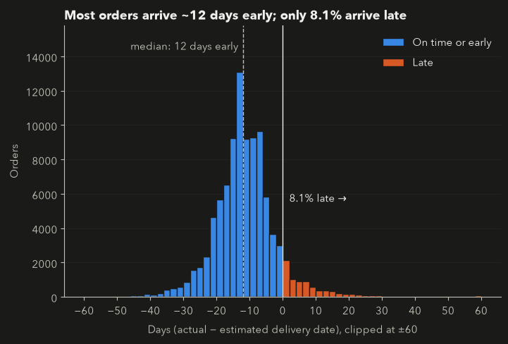
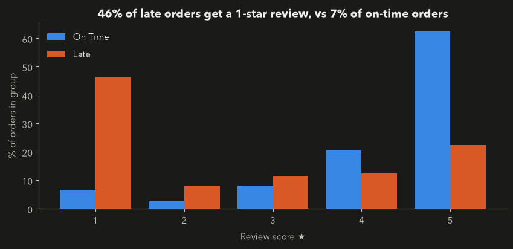
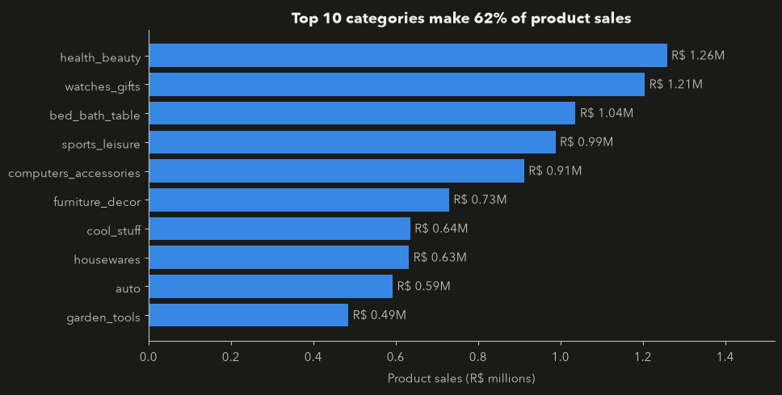
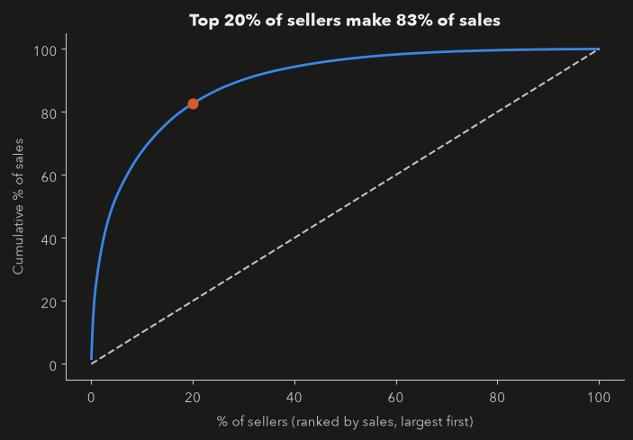

# E-Commerce Decision Intelligence Platform

**Where does a marketplace's money come from, and what do late deliveries cost it?** An analysis of 99,441 Brazilian e-commerce orders with PostgreSQL, SQL and pandas. A Tableau dashboard and a late-delivery model are planned.

**Status: in progress.** The SQL analysis and three notebooks are finished.

| Orders | Customer payments | Average order value | Delivered late | Customers who returned |
|:---:|:---:|:---:|:---:|:---:|
| 99,441 | R$16.0M | R$160.99 | 8.1% | 2.2% |

*Sept 2016 to Oct 2018. All money is in Brazilian reais (R$). Average order value is customer payments divided by the 99,440 orders that have a payment record.*

## Key findings

- **Delivery is reliable, and the estimates are cautious.** 8.1% of delivered orders arrive late. The median order arrives about 12 days before its estimated date.
- **Late delivery goes with bad reviews.** 46% of late orders get a 1-star review, against 7% of on-time orders. This is an association, not proof that lateness causes low scores.
- **A few categories carry the sales.** The top 10 of 74 product categories make up 62% of product sales. Among them, `bed_bath_table` has the most orders but the lowest average review (3.97 against 4.09 overall).
- **A small group of sellers drives the marketplace.** The top 20% of sellers make about 83% of product sales, and 130 of 3,095 sellers make half.
- **Lateness is uneven.** Late rates range from 2.9% (RO) to 23.9% (AL), with the Northeast worst. Orders that cross state lines are late 9.2% of the time, against 6.0% within a state. Sellers with higher late rates tend to have lower reviews (correlation -0.50 across 425 sellers). This is an association, not proof of cause.
- **Few customers return.** Only about 2.2% of customers (2,070 of 96,096) came back at least a day after their first order. A simple count of customers with 2 or more orders gives 3.1%, but about 31% of those "repeat" customers reordered within a day, which looks like one purchase split into two orders.
- **Returning customers spend more, but there are too few to drive revenue.** They spend about R$329 each against R$163 for one-time customers, yet make up only 2.2% of customers and 4.4% of revenue.

<table>
  <tr>
    <td width="50%"><br><sub>Most orders arrive well before the estimated date.</sub></td>
    <td width="50%"><br><sub>Late orders are far more likely to get 1 star.</sub></td>
  </tr>
  <tr>
    <td width="50%"><br><sub>The top 10 categories make up 62% of product sales.</sub></td>
    <td width="50%"><br><sub>The top 20% of sellers make about 83% of sales.</sub></td>
  </tr>
</table>

## The business problem

A marketplace sells through thousands of independent sellers. This project asks where the money comes from, which categories and sellers matter most, how reliable delivery is and whether it affects reviews, and whether customers come back.

## Data

The **Olist Brazilian E-Commerce Public Dataset** on [Kaggle](https://www.kaggle.com/datasets/olistbr/brazilian-ecommerce): about 99,000 orders across nine related tables. The raw files are not stored in this repository. See the dataset page for its license and terms. The table relationships are in the [ER diagram](docs/erd.md).

## How the analysis was done

- **Grain first.** Each table is reduced to one row per order before joining, and row counts are checked after every join.
- **Clear metric definitions.** Customer payment value (`payment_value`) and product sales (`price`, excluding freight) are kept separate. Repeat customers use `customer_unique_id`.
- **Late means delivered after the estimated date.** Undelivered orders are never counted as on time.
- **Returning is not the same as repeat.** "Returning" means a second order at least a day after the first.
- **Latest review per order**, chosen with a SQL window function.
- **Data limits.** Months at the edges of the dataset contain very few orders and are not treated as trends.

## Reproduce it

You need Python 3.11 or newer and PostgreSQL. The notebooks connect to a local database named `ecommerce` without a password.

```bash
python3 -m venv .venv
source .venv/bin/activate
pip install -r requirements.txt
python scripts/download_data.py
createdb ecommerce
psql -d ecommerce -f sql/schema.sql
psql -d ecommerce -f sql/load_data.sql
```

Then run `notebooks/01_business_analysis.ipynb`, or `sql/analysis.sql` in `psql`.

## Repository structure

```text
.
├── sql/        schema.sql, load_data.sql, analysis.sql (13 business questions)
├── notebooks/  01 business, 02 customer, 03 delivery failure, 04 planned model
├── scripts/    download_data.py
├── docs/       ER diagram and project specification
├── images/     charts used in this README
├── dashboard/  planned Tableau dashboard
└── requirements.txt
```

## Roadmap

- [x] Reproducible data download, PostgreSQL schema and loading, ER diagram
- [x] SQL business analysis (13 questions)
- [x] Python analysis: delivery, reviews, categories, seller concentration
- [x] Customer analysis and delivery failure analysis
- [ ] Tableau executive dashboard
- [ ] Late-delivery classification model, using only information known before delivery
- [ ] Final recommendations

**Tools:** PostgreSQL, SQL, Python (pandas, matplotlib, SQLAlchemy), Jupyter. Tableau and scikit-learn are planned.
